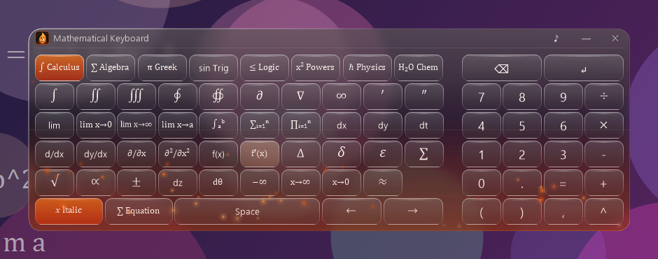
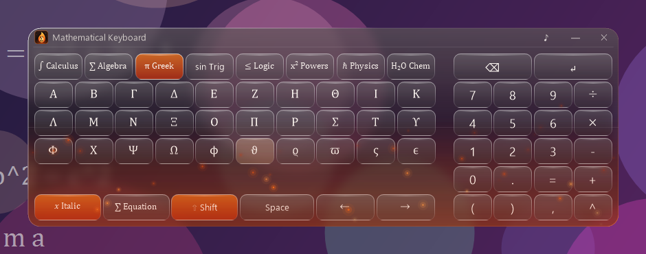

# Mathematical Keyboard — لوحة المفاتيح الرياضية

[English](README.md)

لوحة مفاتيح على الشاشة لويندوز (مثل On-Screen Keyboard) مخصصة للرموز الرياضية والعلمية، تُستخدم بالماوس فقط.
تضغط الزر فيُكتب الرمز في أي برنامج مفتوح مكان المؤشر، بدون ما تسرق اللوحة التركيز من البرنامج الذي تكتب فيه.

| | |
|---|---|
|  |  |

> الصور أعلاه لقطات حقيقية للنافذة الحية فوق خلفية ملونة، ويظهر فيها غبش الخلفية خلف الزجاج.

---

## المحتويات
1. [التشغيل والمتطلبات](#1-التشغيل-والمتطلبات)
2. [واجهة البرنامج](#2-واجهة-البرنامج)
3. [الصفحات والرموز](#3-الصفحات-والرموز)
4. [الأوضاع: Italic وEquation وShift](#4-الأوضاع)
5. [الكتابة داخل Word والمعادلات](#5-الكتابة-داخل-word-والمعادلات)
6. [الصوت](#6-الصوت)
7. [الإعدادات والملفات](#7-الإعدادات-والملفات)
8. [كيف يعمل (تقني)](#8-كيف-يعمل-تقني)
9. [البناء من الكود](#9-البناء-من-الكود)
10. [تخصيص الأزرار](#10-تخصيص-الأزرار)
11. [القيود المعروفة](#11-القيود-المعروفة)
12. [حل المشاكل](#12-حل-المشاكل)

---

## 1. التشغيل والمتطلبات

**التشغيل:** ابنِ البرنامج بأمر واحد (انظر [البناء من الكود](#9-البناء-من-الكود)) ثم شغّل `bin\MathKeyboard.exe`. لا يحتاج تثبيت أي أدوات.

**أو حمّل الملف الجاهز:** نزّل MathKeyboard-v1.0.0-win.zip من صفحة [Releases](https://github.com/mohammedtaleb-dev/mathematical-keyboard/releases)، فكّه، وشغّل MathKeyboard.exe. البرنامج غير موقّع رقميًا، فقد يظهر تحذير ويندوز SmartScreen: اضغط **More info** ثم **Run anyway**.

**المتطلبات**
- ويندوز 10 (جُرّب على Windows 10 الإصدار 19045).
- .NET Framework 4.x، وهو موجود مسبقًا في ويندوز 10، فما تحتاج تثبّت شيئًا.
- بطاقة صوت للأصوات (اختياري، ويمكن كتمها).

**الإغلاق:** زر ✕ في الشريط العلوي.

---

## 2. واجهة البرنامج

```
┌──────────────────────────────────────────────────────────────────┐
│ لوجو  Mathematical Keyboard                          ♪   —   ✕   │  ← شريط العنوان
├──────────────────────────────────────────┬───────────────────────┤
│ [∫][∑][π][sin][≤][x²][ℏ][H₂O]  تبويبات  │   ⌫           ↵       │
│ ┌──┬──┬──┬──┬──┬──┬──┬──┬──┬──┐         │  7   8   9   ÷        │
│ │  │  │  │  │  │  │  │  │  │  │  شبكة   │  4   5   6   ×        │
│ │  │  │  │  │  │  │  │  │  │  │  الرموز │  1   2   3   -        │
│ └──┴──┴──┴──┴──┴──┴──┴──┴──┴──┘         │  0   .   =   +        │
│ [Italic][Equation][Shift*][ Space ][←][→]│  (   )   ,   ^        │
└──────────────────────────────────────────┴───────────────────────┘
                                          * Shift يظهر في صفحة اليونانية فقط
```

- **سحب النافذة:** اسحب من شريط العنوان.
- **تغيير الحجم:** اسحب الزاوية اليمنى السفلية. الحجم الافتراضي 860×290 (يتكيف مع مقياس الشاشة DPI).
- **زر ♪:** كتم الصوت / تشغيله. تظهر عليه شرطة مائلة عند الكتم.
- **زر —:** تصغير. **زر ✕:** إغلاق.
- النافذة دائمًا فوق باقي النوافذ ولا تأخذ التركيز: البرنامج الذي تكتب فيه يبقى هو النشط.
- لوحة الأرقام على اليمين ثابتة في كل الصفحات: `0-9 . = + - × ÷ ( ) , ^` مع `⌫` و`↵`.
- الضغط المطوّل على `⌫` و`Space` و`←` و`→` يكرر الإدخال.

---

## 3. الصفحات والرموز

التبويبات تتبدل بالماوس، مع حركة انزلاق للرموز وتظليل متحرك للتبويب النشط.

| التبويب | المحتوى |
|---|---|
| **∫ Calculus** | `∫ ∬ ∭ ∮ ∯ ∂ ∇ ∞ ′ ″` — أزرار منظّمة: `lim` و`lim x→0` و`lim x→∞` و`lim x→a` و`∫ₐᵇ` و`∑ᵢ₌₁ⁿ` و`∏ᵢ₌₁ⁿ` و`d/dx` و`dy/dx` و`∂/∂x` و`∂²/∂x²` — وأيضًا `dx dy dz dt dθ f(x) f′(x) Δ δ ε ∑ √ ∝ ± −∞ x→∞ x→0 ≈` |
| **∑ Algebra** | `∑ ∏ √ ∛ ! ^ _ / [ ]` — منظّمة: `√x` و`ⁿ√x` و`a/b` و`xⁿ` و`xₙ` و`\|x\|` — ثم `± ∓ × ÷ · ∘ % ° ∠ ⟂` والمتغيرات `x y z n a b` والأقواس `⌊ ⌋ ⌈ ⌉ { } < >` |
| **π Greek** | كل الحروف اليونانية الصغيرة بما فيها النماذج البديلة `ϕ ϑ ϱ ϖ ς ϵ`. زر **Shift** يحولها إلى الحروف الكبيرة (σ←Σ، δ←Δ، ω←Ω) |
| **sin Trig** | `sin cos tan cot sec csc` والمعكوسة `sin⁻¹ cos⁻¹ tan⁻¹` و`arcsin arccos arctan` و`sinh cosh tanh` و`log ln exp abs` و`π θ ° rad e eˣ √ ( )` — مفاتيح الدوال تكتب الاسم مع القوس، مثل `sin(` |
| **≤ Logic** | العلاقات `≤ ≥ ≠ ≈ ≡ ≅ ∼`، المجموعات `∈ ∉ ∋ ⊂ ⊃ ⊆ ⊇ ∪ ∩ ∅ ∖`، المنطق `∀ ∃ ∄ ¬ ∧ ∨ ⇒ ⇔`، الأسهم `→ ← ↔ ↦`، `∴ ∵`، والأعداد `ℕ ℤ ℚ ℝ ℂ` |
| **x² Powers** | الأسس `⁰¹²³⁴⁵⁶⁷⁸⁹ ⁺⁻⁼⁽⁾ⁿⁱˣʸᶻ` والأدلة `₀₁₂₃₄₅₆₇₈₉ ₊₋₌₍₎ₙₓᵢⱼₐ` |
| **ℏ Physics** | `ℏ ħ ∇ ∂ ∮ ∝ ≈ ∞ ± ∓`، `Δ Ω ω λ μ ν ρ σ τ ε`، `° Å ℃ ‰ · ⟨ ⟩ ⊥ ∥` وسهم المتجه `a⃗`، والوحدات `kg m/s m/s² N J W Hz Pa eV mol` |
| **H₂O Chem** | أسهم التفاعل `→ ⇌ ⇄ ↑ ↓ Δ`، حالات المادة `(s) (l) (g) (aq)`، الأدلة والشحنات، والصيغ الجاهزة `H₂O CO₂ O₂ H₂ N₂ NH₃ CH₄ NaCl HCl H₂SO₄` |

ملاحظة: الأزرار الرمزية تكتب رموز Unicode عادية، وما تحتاج أن تكون لغة الكيبورد معينة.

---

## 4. الأوضاع

الصف السفلي فيه ثلاثة أزرار تبديل. الزر المفعّل يظهر بلون الجمر.

### `𝑥 Italic` — الخط المائل (مفعّل افتراضيًا)
يكتب المتغيرات بحروف الرياضيات المائلة من كتلة Unicode «Mathematical Italic»، مثل `𝑥 𝑦 𝑧 𝑛 𝑎 𝑏` وحروف اليونانية الصغيرة `𝛼 𝛽 𝜋 𝜃 𝜆`.
- الدوال والأرقام والرموز تبقى بخط عادي، وكذلك الحروف اليونانية الكبيرة (Π وΩ).
- لو برنامج ما يدعم هذه الرموز ويعرضها مربعات، أطفئ Italic.
- ملاحظة: داخل وضع المعادلات (Equation) لا تُرسل الحروف المائلة، لأن محرر المعادلات يميلها بنفسه.

### `∑ Equation` — وضع المعادلات
يجعل الأزرار المنظّمة تكتب **صيغة المعادلات الخطية** (UnicodeMath) التي يحوّلها Word وPowerPoint وOneNote إلى معادلة منسّقة (انظر القسم التالي).
إذا كان Word أو PowerPoint أو OneNote هو البرنامج النشط عند تفعيله، يرسل البرنامج `Alt+=` تلقائيًا لبدء معادلة جديدة. عند إطفائه لا يرسل شيئًا، وتخرج من المعادلة بالأسهم أو بالطريقة المعتادة في Word.

### `⇧ Shift` — يظهر في صفحة Greek فقط
يحوّل الحروف اليونانية إلى كبيرة. يتوقف تلقائيًا عند الخروج من الصفحة.

---

## 5. الكتابة داخل Word والمعادلات

في المحرّرات النصية العادية (Notepad وغيره) لا يوجد تنسيق رياضي أصلًا، فلا يمكن وضع نهاية الحد **تحت** `lim`. التنسيق الحقيقي موجود في معادلات Word وPowerPoint وOneNote.

**طريقة الاستخدام**
1. افتح Word واضغط داخل المستند.
2. اضغط `∑ Equation` في اللوحة، فتبدأ معادلة جديدة ويتفعل الوضع.
3. اضغط الأزرار المنظّمة، مثل `lim x→0`.

| الزر | يكتب في وضع المعادلات | النتيجة في Word |
|---|---|---|
| `lim x→0` | `lim_(x→0) ` | lim مع `x→0` تحتها |
| `lim x→∞` | `lim_(x→∞) ` | lim مع `x→∞` تحتها |
| `∫ₐᵇ` | `∫_a^b ` | تكامل بحدّين |
| `∑ᵢ₌₁ⁿ` | `∑_(i=1)^n ` | مجموع بحدّ سفلي وعلوي |
| `d/dx` | `d/dx ` | كسر |
| `√x` | `√(x) ` | جذر |
| `ⁿ√x` | `√(n&x) ` | جذر نوني |
| `a/b` | `a/b ` | كسر |
| `xⁿ` | `x^n ` | أس |

بعد كل أمر منظّم تُرسل مسافة، وهي التي تجعل Word يبني الشكل. بعد البناء يصبح المؤشر داخل المعادلة، فاكتب بقية التعبير. للخروج من المعادلة استخدم الأسهم (`→` في اللوحة) كما تفعل في Word عادةً.

**خارج وضع المعادلات** (أو في برنامج لا يدعم المعادلات) تكتب نفس الأزرار نصًا عاديًا بأقرب شكل ممكن، مثل `limₓ→₀` و`∫ₐᵇ` و`∑ᵢ₌₁ⁿ`.

**ما اختُبر**
- ضغطات ماوس حقيقية داخل Word على زر `lim x→0`، ثم سؤال Word عن النتيجة: بُنيت دالة حدّ (LimLow) وفي الجزء السفلي منها `𝑥→0`.
- كل صيغ الجدول أعلاه (باستثناء `lim` وحدها) أُدخلت في Word عبر الأتمتة وطُلب منه بناؤها، فبنى الشكل المتوقع: حدّ، تكامل، مجموع، حاصل ضرب، كسر، جذر، جذر نوني، أس، دليل، قيمة مطلقة (16 من 17 صيغة، والـ 17 هي `lim` وحدها وتبقى نصًا عاديًا بخط المعادلات لأن الدالة تحتاج نهاية).
- لم أختبر كل صيغة بضغطة ماوس منفصلة داخل Word، ولم أختبر PowerPoint ولا OneNote.

---

## 6. الصوت

أصوات كيبورد ميكانيكي مولَّدة برمجيًا (لا توجد ملفات صوتية ولا حقوق خارجية):
- **ضغط:** نقرة حادة + صوت بلاستيك + «ثوك» منخفض من هيكل الكيبورد.
- **رفع:** نقرة أخف وأعلى عند ترك الزر.
- **Space وEnter وBackspace:** أعمق، مع طقطقة خفيفة تشبه ماسك المفتاح الكبير.
- ست نغمات مختلفة قليلًا تتبدل عشوائيًا حتى لا يتكرر الصوت.
- التكرار عند الضغط المطوّل بنصف القوة.
- أصوات متعددة تتداخل عند الكتابة السريعة (خلّاط بسيط فوق WinMM). ولا يستهلك المعالج وهو ساكت.

لمعاينة الأصوات قبل التشغيل: `MathKeyboard.exe --sounds out.wav`.
زر ♪ يكتم الصوت، ويُحفظ الاختيار.

---

## 7. الإعدادات والملفات

**إعدادات المستخدم:** `%APPDATA%\MathKeyboard\settings.txt`
- `muted=1` الصوت مكتوم، `muted=0` الصوت يعمل.
- الأوضاع الأخرى (Italic وEquation) ما تُحفظ، وتبدأ كل مرة بـ Italic مفعّل وEquation مطفأ.

**ملفات المشروع**

| الملف | الوظيفة |
|---|---|
| `src/KeyboardForm.cs` | النافذة، الصفحات والمفاتيح، الرسم (الزجاج والجمر)، الحركات، منطق الضغط، نقطة الدخول `Main` |
| `src/Native.cs` | إرسال الإدخال (`SendInput`)، تغبيش الخلفية، سطح النافذة الشفاف، تحويل الحروف للمائلة، تعريف `Key` |
| `src/Audio.cs` | تركيب أصوات الكيبورد ومزج الصوت (WinMM) |
| `src/Logo.cs` | رسم اللوجو برمجيًا وتوليد ملف الأيقونة |
| `build.ps1` | سكربت البناء |
| `assets/logo.png` | اللوجو |
| `docs/screenshots/` | لقطات الشاشة |
| `bin/` | ناتج البناء (التنفيذي والأيقونة)، غير مرفوع إلى Git |

---

## 8. كيف يعمل (تقني)

- **عدم سرقة التركيز:** النافذة بنمط `WS_EX_NOACTIVATE` و`WS_EX_TOPMOST`، وترد على `WM_MOUSEACTIVATE` بـ `MA_NOACTIVATE`. فالنقر عليها لا ينقل التركيز.
- **الكتابة:** `SendInput` مع `KEYEVENTF_UNICODE`، فتُكتب الرموز بغض النظر عن لغة الكيبورد. `⌫ ↵ Space ← →` تُرسل كمفاتيح حقيقية (Virtual Keys). الرموز خارج BMP (مثل 𝑥) تُرسل كزوج surrogate.
- **الزجاج:** نافذة بنمط `WS_EX_LAYERED` يُرسم محتواها بـ GDI+ في صورة DIB بشفافية لكل بكسل (premultiplied alpha) وتُرسل بـ `UpdateLayeredWindow`. يُفعَّل تغبيش الخلفية بسياسة `ACCENT_ENABLE_BLURBEHIND` عبر `SetWindowCompositionAttribute`، وتُقصّ النافذة بزوايا مستديرة.
- **الأداء:** طبقة الأزرار تُرسم في صورة مخزّنة وتُعاد رسمها فقط عند التغيّر (تحويم، ضغط، حركة تبويب). كل إطار (حوالي 30/ثانية) يلصق الصورة ثم يرسم الوهج المتذبذب والجمر فوقها. الاستهلاك وهو ساكت حوالي 2–4% من نواة واحدة وحوالي 30 ميغابايت.
- **الجمر:** نظام جسيمات (38 شرارة): تصعد من الأسفل وتتمايل وتتبدل ألوانها من الأصفر إلى الأحمر وتتلاشى.
- **الحروف المائلة:** تحويل مباشر إلى كتلة Mathematical Italic (`U+1D434…`)، مع استثناء `h` لأن مكانها محجوز، فتُكتب `ℎ` (U+210E).
- **الصوت:** تركيب بالقناة الأحادية 44.1kHz 16 بت: ضجيج أبيض يمر بمرنان ثنائي القطب (الطقة)، وجيوب مخمدة (الثوك)، ثم خلّاط يملأ ثلاث مخازن صغيرة (10 مللي ثانية لكل منها) ويغفو عند عدم وجود صوت.

---

## 9. البناء من الكود

لا يحتاج أي أدوات إضافية: يستخدم مترجم C# المدمج في ويندوز (`csc.exe` من .NET Framework 4).

```powershell
powershell -ExecutionPolicy Bypass -File .\build.ps1
```

يبني السكربت الملف `bin\MathKeyboard.exe` على مرحلتين: الأولى بدون أيقونة لتوليد `bin\MathKeyboard.ico` و`assets\logo.png`، والثانية تدمج الأيقونة في الملف التنفيذي.

> الكود مكتوب بصيغة C# 5 لأن المترجم المدمج قديم: لا `?.` ولا `$"..."`.

**أوضاع سطر الأوامر (للاختبار)**

| الأمر | الوظيفة |
|---|---|
| `MathKeyboard.exe --snap out.png [page] [shift\|-] [animSeconds] [color\|light\|dark]` | يرسم إطارًا واحدًا فوق خلفية اختبار ويحفظه صورة، ثم يخرج |
| `MathKeyboard.exe --icon out.ico [logo.png]` | يكتب أيقونة التطبيق (وصورة معاينة اختيارية) |
| `MathKeyboard.exe --sounds out.wav` | يكتب معاينة صوتية، ويشغّل الأصوات مرة، ويسجل حالة المخلّط في `out.wav.log` |
| `MathKeyboard.exe --send "نص" [delayMs]` | يكتب النص في البرنامج النشط بعد تأخير (لاختبار `SendInput`) |

عند حدوث خطأ غير متوقع يُكتب في `%TEMP%\mathkeyboard-error.txt`.

---

## 10. تخصيص الأزرار

الصفحات معرّفة في الدالة `BuildPages()` داخل `src/KeyboardForm.cs`، وكل صفحة تتسع لـ 40 زرًا (4 صفوف × 10).

```csharp
S(p, "∫ ∬ ∭");                       // رموز مفردة: الاسم نفسه هو الناتج (المسافات للفصل فقط)
S(p, "x y z", true);                 // true = متغيّر يُكتب مائلًا عند تفعيل Italic
T(p, "sin", "sin(");                 // زر بنص ظاهر وناتج مختلف
TE(p, "lim x→0",                     // زر منظّم:
     "limₓ→₀",                       //   الناتج في الوضع العادي
     "lim_(x→0) ");                  //   الناتج في وضع المعادلات (لاحظ المسافة في آخره)
```

- الأزرار تُرتب بالتسلسل، 10 في الصف.
- أضف تبويبًا جديدًا: ضع اسمه في المصفوفة `tabNames` وأضف صفحته إلى `pages` بنفس الترتيب.
- بعد التعديل شغّل `build.ps1`.

---

## 11. القيود المعروفة

- **التنسيق الرياضي الحقيقي** (النهاية تحت lim، الكسور، الجذور) لا يعمل إلا داخل معادلات Word وPowerPoint وOneNote. في غيرها يُكتب نص Unicode فقط.
- **الحروف المائلة** (𝑥 𝜋) تحتاج برنامجًا بخط بديل يدعم كتلة Mathematical Alphanumeric Symbols. Word وNotepad في ويندوز 10 يدعمونها، وجُرّب Notepad.
- **البرامج المرفوعة الصلاحيات** (تعمل كمسؤول): ويندوز يمنع البرامج العادية من إرسال إدخال لها، فقد لا تكتب فيها اللوحة. شغّل اللوحة كمسؤول في هذه الحالة. (قيد معروف في ويندوز ولم أختبره هنا.)
- **بعض البرامج** لا تقبل إدخال Unicode (بعض الألعاب والتطبيقات القديمة وجلسات سطح المكتب البعيد).
- **الزجاج** يعتمد على واجهة غير موثّقة في ويندوز 10 (`SetWindowCompositionAttribute`). لم تُجرَّب على ويندوز 11، وقد يختلف الغبش فيه.
- **الاختبار:** جُرّب على Windows 10 (19045) بمقياس شاشة 100%. المقاييس الأخرى مدعومة نظريًا عبر DPI لكنها لم تُختبر.
- **الصوت:** مصنّع برمجيًا، وجودته أقل من تسجيل كيبورد حقيقي. إن أردت صوتًا آخر فيمكن استبداله بملفات WAV.
- **اللوجو** من تصميم أصلي (حرف ∑ داخل لهب)، وليس مأخوذًا من الإنترنت.

---

## 12. حل المشاكل

| المشكلة | الحل |
|---|---|
| تضغط ولا يُكتب شيء | تأكد أن مؤشر الكتابة داخل حقل نصي في البرنامج المطلوب. جرّب Notepad. إن كان البرنامج يعمل كمسؤول فشغّل اللوحة كمسؤول. |
| الرموز المائلة تظهر مربعات | أطفئ زر Italic. |
| `lim_(x→0)` ظهر كنص حرفي في Word | لم تكن داخل معادلة. اضغط `∑ Equation` (أو `Alt+=`) أولًا. |
| لا غبش في الخلفية | قد يكون ويندوز 11 أو إعدادات الشفافية/توفير الطاقة مفعّلة. تحقق من «الشفافية» في إعدادات الألوان. |
| لا يوجد صوت | تأكد أن زر ♪ غير مكتوم، وأن ويندوز لديه جهاز صوت افتراضي. جرّب `--sounds`. |
| النافذة اختفت | ابحث عنها في شريط المهام (قد تكون مصغّرة). |
| انهيار عند التشغيل | افتح `%TEMP%\mathkeyboard-error.txt` وأرسله. |
