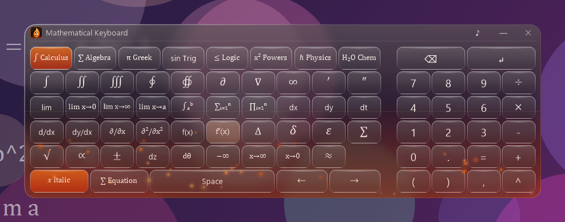
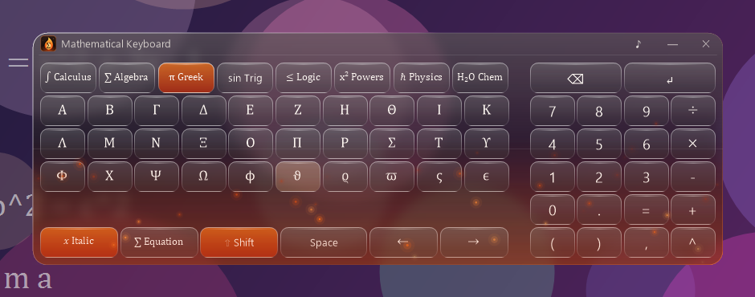
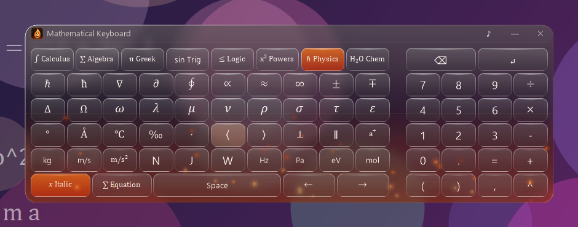
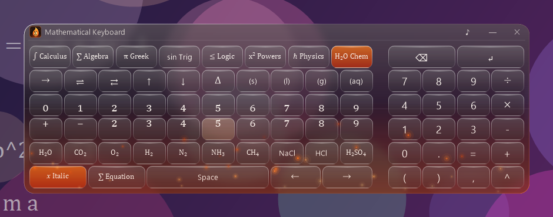
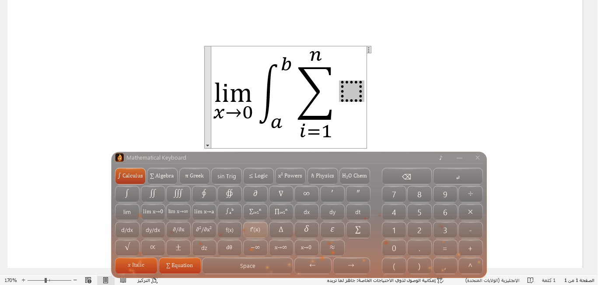

<div align="center">


# Mathematical Keyboard

**A mouse-driven, liquid-glass on-screen keyboard for math, physics and chemistry symbols on Windows.**

Click a key and the symbol is typed into whatever app you are using, such as Word, Notepad or a browser. No installation and no dependencies; it builds with the compiler that already ships with Windows.

</div>



## Why

Typing `∫`, `∑`, `π`, `ℏ` or `H₂O` on a normal keyboard means memorising Alt codes, hunting through Character Map, or relying on shortcuts. This works like Windows' own On-Screen Keyboard, but the keys are the symbols you actually need, sorted into pages, and everything is done with the mouse.

## Features

- **Eight symbol pages** with a number pad that is always visible:
  `∫ Calculus` · `∑ Algebra` · `π Greek` · `sin Trig` · `≤ Logic` · `x² Powers` · `ℏ Physics` · `H₂O Chem`
- **Types into any app** using Unicode `SendInput`, independent of your keyboard layout. The window never takes focus, so your cursor stays where it was.
- **Real equations in Word, PowerPoint and OneNote.** In *Equation* mode, keys such as `lim x→0` produce a typeset limit with `x→0` *underneath* `lim`, not beside it.
- **Math italic** for variables (`𝑥`, `𝜋`, `𝜃`) so typed text looks like an equation. It can be switched off.
- **Greek capitals** through a Shift key that appears only on the Greek page (`σ → Σ`, `ω → Ω`).
- **Liquid-glass interface:** the window blurs what is behind it, with glossy keys, a warm ember glow and drifting sparks.
- **Sliding page transitions** with an animated tab highlight.
- **Mechanical-keyboard sounds** (key down and key up, heavier for Space/Enter/Backspace), synthesized in code, with a mute button.
- A single ~115 KB executable, about 30 MB of RAM and 2–4 % of one CPU core when idle.

<table>
  <tr>
    <td></td>
    <td></td>
  </tr>
  <tr>
    <td align="center"><sub>Greek capitals via Shift</sub></td>
    <td align="center"><sub>Physics: ℏ, units, vectors</sub></td>
  </tr>
  <tr>
    <td></td>
    <td></td>
  </tr>
  <tr>
    <td align="center"><sub>Chemistry: reaction arrows, states, formulas</sub></td>
    <td align="center"><sub>Equation mode inside Word</sub></td>
  </tr>
</table>

## Download

Get **MathKeyboard-v1.0.0-win.zip** from the [Releases page](https://github.com/mohammedtaleb-dev/mathematical-keyboard/releases), unzip it and run MathKeyboard.exe.

The app is not code-signed, so Windows SmartScreen may show *Windows protected your PC*: click **More info -> Run anyway**. Prefer not to run a downloaded binary? Build it yourself (next section); all the source is in src/.

## Getting started

**Requirements:** Windows 10 (built and tested on 10.0.19045). The .NET Framework 4 that is already part of Windows is all you need.

```powershell
git clone https://github.com/mohammedtaleb-dev/mathematical-keyboard.git
cd mathematical-keyboard
powershell -ExecutionPolicy Bypass -File .\build.ps1
.\bin\MathKeyboard.exe
```

`build.ps1` compiles `src\*.cs` with the `csc.exe` that ships with Windows and also generates the app icon. There is no SDK, NuGet or Visual Studio involved.

## Using it

1. Click into any text field in another program.
2. Click keys on the keyboard window. The symbol appears at your cursor.
3. Switch pages with the tabs along the top. Drag the title bar to move the window and the bottom-right corner to resize it.

| Control | What it does |
|---|---|
| `𝑥 Italic` | Type variables as math italic (on by default) |
| `∑ Equation` | Type structured keys as real equations in Word, PowerPoint and OneNote |
| `⇧ Shift` | Greek capitals (only on the Greek page) |
| `♪` | Mute or unmute the sounds (remembered between runs) |
| Hold `⌫` `Space` `←` `→` | Auto-repeat |

### Equation mode (Word, PowerPoint, OneNote)

Plain-text editors have no math layout, so the best they can show is something like `limₓ→₀`. Office apps can build real equations from *linear format*, so with `∑ Equation` on, the structured keys type that format and Office turns it into a typeset equation:

| Key | Types | You get |
|---|---|---|
| `lim x→0` | `lim_(x→0) ` | `lim` with `x→0` underneath |
| `∫ₐᵇ` | `∫_a^b ` | integral with limits |
| `∑ᵢ₌₁ⁿ` | `∑_(i=1)^n ` | sum with bounds |
| `d/dx`, `a/b` | `d/dx `, `a/b ` | fraction |
| `√x`, `ⁿ√x` | `√(x) `, `√(n&x) ` | square root, nth root |
| `xⁿ`, `xₙ` | `x^n `, `x_n ` | superscript, subscript |

When Word, PowerPoint or OneNote is the active window, turning Equation mode on also presses `Alt+=` to start an equation for you.

**What has been checked:** with the keyboard clicked by a real mouse in Word, `lim x→0` produced a limit object with `x→0` as its lower limit. In addition, 16 of the 17 templates above (everything except a bare `lim`) were fed to Word through automation and each built the expected structure. PowerPoint and OneNote have not been tested.

## How it works

- **No focus stealing:** the window uses `WS_EX_NOACTIVATE` and `WS_EX_TOPMOST` and answers `WM_MOUSEACTIVATE` with `MA_NOACTIVATE`, so clicking it does not move focus away from your document.
- **Typing:** `SendInput` with `KEYEVENTF_UNICODE` for symbols (surrogate pairs for math italic), and real virtual-key events for Backspace, Enter, Space and the arrows.
- **Glass:** a layered window (`WS_EX_LAYERED`) painted by GDI+ into a premultiplied-alpha DIB and pushed with `UpdateLayeredWindow`, over the blur-behind effect from `SetWindowCompositionAttribute`.
- **Performance:** keys and labels are cached in a bitmap that is redrawn only when something changes; each ~30 fps frame just blits it and draws the flickering glow and sparks on top.
- **Sound:** no sample files. Each key is white noise through a resonator (click and plastic body) plus a damped sine with a downward pitch glide (case "thock"), mixed on a small WinMM wave-out mixer that sleeps when idle.

### Source layout

| Path | Purpose |
|---|---|
| `src/KeyboardForm.cs` | Window, symbol pages, drawing, animation, input handling, `Main` |
| `src/Native.cs` | `SendInput`, backdrop blur, layered-window surface, math-italic mapping, `Key` type |
| `src/Audio.cs` | Sound synthesis and mixer |
| `src/Logo.cs` | Draws the logo and builds the `.ico` |
| `build.ps1` | Build script |

### Customising keys

Pages are built in `BuildPages()` in `src/KeyboardForm.cs`; each page holds up to 40 keys (4 rows of 10).

```csharp
S(p, "∫ ∬ ∭");                 // plain symbols: the label is what gets typed
S(p, "x y z", true);           // true = variable, typed as math italic when Italic is on
T(p, "sin", "sin(");           // label and typed text differ
TE(p, "lim x→0",               // structured key:
     "limₓ→₀",                 //   typed normally
     "lim_(x→0) ");            //   typed in Equation mode
```

To add a tab, add its name to `tabNames` and its page to `pages`, in the same order.

### Command-line switches (for testing)

| Command | Purpose |
|---|---|
| `MathKeyboard.exe --snap out.png [page] [shift\|-] [animSeconds] [color\|light\|dark]` | Render one frame to an image and exit |
| `MathKeyboard.exe --icon out.ico [logo.png]` | Write the app icon (and a preview PNG) |
| `MathKeyboard.exe --sounds out.wav` | Write a preview of all sounds and play them |
| `MathKeyboard.exe --send "text" [delayMs]` | Type text into the active window after a delay |

Unexpected errors are written to `%TEMP%\mathkeyboard-error.txt`. The mute setting is stored in `%APPDATA%\MathKeyboard\settings.txt`.

## Known limitations

- Real equation layout (limits, fractions, roots) only works in Word, PowerPoint and OneNote. Everywhere else you get Unicode text.
- Math italic characters (`𝑥`, `𝜋`) need an app and font that support the Mathematical Alphanumeric Symbols block. Notepad and Word do; if you see boxes, turn Italic off.
- Windows blocks normal programs from sending input to elevated (administrator) windows. Run the keyboard as administrator to type into those.
- Some apps ignore Unicode input, such as certain games, older software and remote-desktop sessions.
- The glass blur relies on an undocumented Windows 10 API. It has only been tested on Windows 10 at 100 % display scale; Windows 11 and other scale factors are untested.
- The sounds are synthesized and will not match a recording of a real keyboard.

## Related projects

Nothing found on GitHub does quite the same thing; these are the closest:

- [sitandr/math_keyboard](https://github.com/sitandr/math_keyboard): a physical-keyboard layout for Windows with dead keys for math and Greek.
- [InterCentury/Math-Keyboard](https://github.com/InterCentury/Math-Keyboard): an AutoHotkey script that types math and physics symbols from shortcuts.
- [ofirmakmal/SymWin](https://github.com/ofirmakmal/SymWin): a popup symbol picker opened with CapsLock + a letter.

This project differs by being a full on-screen keyboard that you drive entirely with the mouse, with themed pages and real equation output in Office.

## License

[MIT](LICENSE)
